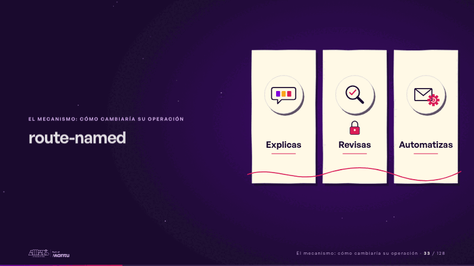
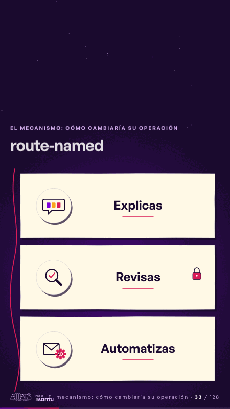

# route-named · El mecanismo: cómo cambiaría su operación

 

## Qué cuenta

Tres paneles de papel plegados en acordeón, con los dibujos de las tres paradas del mapa, y la cinta magenta que los atraviesa.

## Cómo respira

Los paneles se abren uno tras otro y ninguno se cierra: cada dibujo recibe su palabra (explicas, revisas, automatizas) y un candado se asienta sobre revisas. Cuadro final: los tres paneles abiertos y nombrados a la vez, con el candado en revisas.

## Cuándo usarla

Intención: **El mecanismo: cómo cambiaría su operación** (process). Verticales: cualquiera. Layout `left`; mundo papel. Origen: dcd · escena de catálogo (fidelización). El snippet completo, listo para pegar en un storyboard: [`snippets/route-named.json`](../../snippets/route-named.json).

## Args

```json
{
 "layout": "left",
 "scene": "route-named",
 "args": {
  "words": [
   "‹como: Explicas›",
   "‹como: Revisas›",
   "‹como: Automatizas›"
  ]
 }
}
```

## What it is

The mechanism scene, layout «left», for any decks. It lands at a glance, then breathes in a slow loop; its args (words) carry every visible word, so the same scene serves a new client once the texts are rewritten.

## Relacionadas · Related

- [automation-stairs · El mecanismo: cómo cambiaría su operación](automation-stairs.md)
- [before-after-lanes · Antes y después](before-after-lanes.md)
- [before-after-split · Antes y después](before-after-split.md)
- [build-deliver · Formación: la demo en vivo](build-deliver.md)
- [delivery-cycle · El mecanismo: cómo cambiaría su operación](delivery-cycle.md)
- [discovery · Próximo paso: formas de empezar y discovery](discovery.md)

Fuente · source: [`scenes/story/fidelizacion_s01_15.py`](../../scenes/story/fidelizacion_s01_15.py) · sha256 `c89653556c57`
