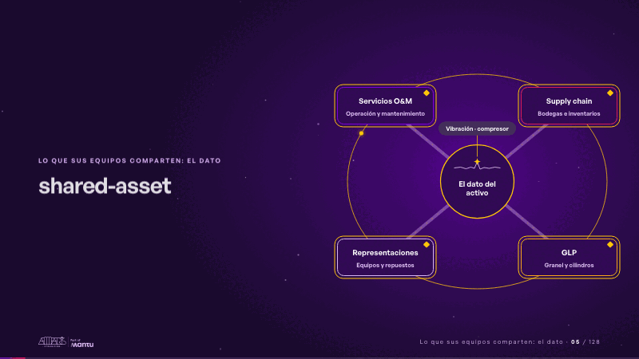
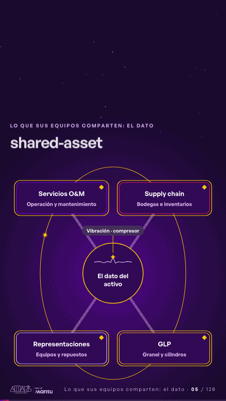

# shared-asset · Lo que sus equipos comparten: el dato

 

## Qué cuenta

Las cuatro líneas, una en cada esquina, se unen por tuberías a un mismo centro: el dato del activo.

## Cómo respira

Una vibración del compresor sale del centro, llega a las cuatro líneas a la vez y cierra un anillo entre ellas.

## Cuándo usarla

Intención: **Lo que sus equipos comparten: el dato** (data). Verticales: energia, cualquiera. Layout `left`. Origen: dcd · escena de catálogo (energía). El snippet completo, listo para pegar en un storyboard: [`snippets/shared-asset.json`](../../snippets/shared-asset.json).

## Args

```json
{
 "layout": "left",
 "scene": "shared-asset",
 "args": {
  "center": "‹como: El dato del activo›",
  "event": "‹como: Vibración · compresor›",
  "lines": [
   [
    "‹como: Servicios O&M›",
    "‹como: Operación y mantenimiento›"
   ],
   [
    "‹como: Supply chain›",
    "‹como: Bodegas e inventarios›"
   ],
   [
    "‹como: Representaciones›",
    "‹como: Equipos y repuestos›"
   ],
   [
    "‹como: GLP›",
    "‹como: Granel y cilindros›"
   ]
  ]
 }
}
```

## What it is

Shared data scene, layout «left», for energia, any decks. It lands at a glance, then breathes in a slow loop; its args (center, event, lines) carry every visible word, so the same scene serves a new client once the texts are rewritten.

## Relacionadas · Related

- [discovery · Próximo paso: formas de empezar y discovery](discovery.md)
- [repeat-story · La brecha: su idea y lo que pasa cuando no se cumple](repeat-story.md)
- [hypotheses-live · Hipótesis por validar](hypotheses-live.md)
- [tickets-live · Cierre: su futuro, funcionando (el lema)](tickets-live.md)
- [hypotheses-quarter · Portada: su promesa](hypotheses-quarter.md)
- [criterion · El criterio: retorno o habilitador](criterion.md)

Fuente · source: [`scenes/story/energia_s04_06.py`](../../scenes/story/energia_s04_06.py) · sha256 `4361cd39f477`
