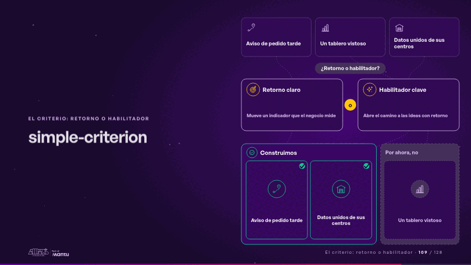
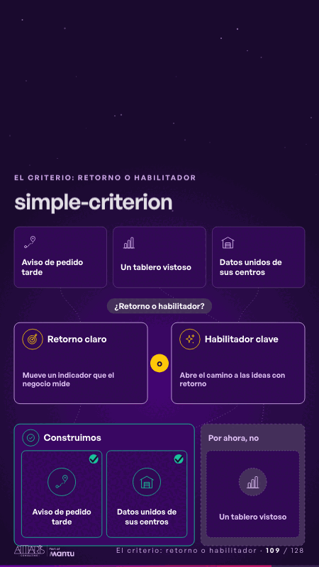

# simple-criterion · El criterio: retorno o habilitador

 

## Qué cuenta

Tres ideas arriba; en el medio, dos puertas, «Retorno claro» o «Habilitador clave»; abajo, dos bandejas: «Construimos» y «Por ahora, no».

## Cómo respira

Cada idea baja por turnos: la del retorno cruza su puerta y entra a «Construimos»; la vistosa se aparta a «Por ahora, no»; la habilitadora cruza la suya y también se construye. Queda: dos ideas construidas y una apartada.

## Cuándo usarla

Intención: **El criterio: retorno o habilitador** (criterion). Verticales: cualquiera. Layout `left`. Origen: Simple · Andina Logística (demo 0.5.0) · diapositiva «Solo construimos si hay retorno claro o habilitador clave». El snippet completo, listo para pegar en un storyboard: [`snippets/simple-criterion.json`](../../snippets/simple-criterion.json).

## Args

```json
{
 "layout": "left",
 "scene": "simple-criterion",
 "args": {
  "criteria": [
   [
    "‹como: Retorno claro›",
    "‹como: Mueve un indicador que el negocio mide›"
   ],
   [
    "‹como: Habilitador clave›",
    "‹como: Abre el camino a las ideas con retorno›"
   ]
  ],
  "or": "‹como: o›",
  "ask": "‹como: ¿Retorno o habilitador?›",
  "ideas": [
   [
    "‹como: Aviso de pedido tarde›",
    "‹como: retorno›"
   ],
   [
    "‹como: Un tablero vistoso›",
    "‹como: no›"
   ],
   [
    "‹como: Datos unidos de sus centros›",
    "‹como: habilitador›"
   ]
  ],
  "build": "‹como: Construimos›",
  "aside": "‹como: Por ahora, no›",
  "icons": [
   "‹como: logistica/ruta›",
   "‹como: generico/dato›",
   "‹como: logistica/bodega›"
  ]
 }
}
```

## What it is

The criterion: return or enabler scene, layout «left», for any decks. It lands at a glance, then breathes in a slow loop; its args (aside, ask, build, criteria, icons, ideas, or) carry every visible word, so the same scene serves a new client once the texts are rewritten.

## Relacionadas · Related

- [adr-decisions · Diseño técnico por capas](adr-decisions.md)
- [criterion · El criterio: retorno o habilitador](criterion.md)
- [criterion-b · El criterio: retorno o habilitador](criterion-b.md)
- [funnel-gates · Embudo](funnel-gates.md)
- [luz-escala · El criterio: retorno o habilitador](luz-escala.md)
- [matrix-quadrants · Matriz](matrix-quadrants.md)

Fuente · source: [`scenes/story/simple_s01_08.py`](../../scenes/story/simple_s01_08.py) · sha256 `17bb4a9a6f5b`
