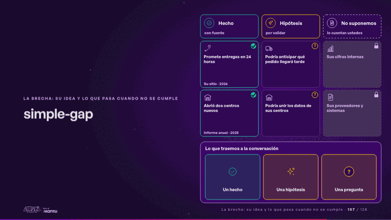
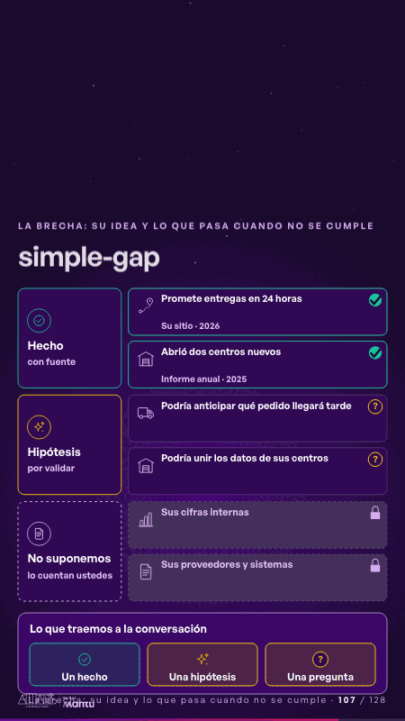

# simple-gap · La brecha: su idea y lo que pasa cuando no se cumple

 

## Qué cuenta

Tres columnas con sus tarjetas: hechos con su fuente, hipótesis con su «?» y, cerrada, lo que no suponemos; abajo, la conversación de hoy, con sus casillas vacías.

## Cómo respira

Cada hecho recibe su visto y su fuente; cada hipótesis enciende su «?»; lo que no suponemos queda con candado. Luego bajan a la conversación solo el hecho y la hipótesis, que se vuelve una pregunta. Queda: la conversación armada con un hecho, una hipótesis y una pregunta.

## Cuándo usarla

Intención: **La brecha: su idea y lo que pasa cuando no se cumple** (gap). Verticales: cualquiera. Layout `left`. Origen: Simple · Andina Logística (demo 0.5.0) · diapositiva «Separamos lo que sabemos de lo que suponemos». El snippet completo, listo para pegar en un storyboard: [`snippets/simple-gap.json`](../../snippets/simple-gap.json).

## Args

```json
{
 "layout": "left",
 "scene": "simple-gap",
 "args": {
  "bins": [
   [
    "‹como: Hecho›",
    "‹como: con fuente›"
   ],
   [
    "‹como: Hipótesis›",
    "‹como: por validar›"
   ],
   [
    "‹como: No suponemos›",
    "‹como: lo cuentan ustedes›"
   ]
  ],
  "known": [
   [
    "‹como: Promete entregas en 24 horas›",
    "‹como: Su sitio · 2026›"
   ],
   [
    "‹como: Abrió dos centros nuevos›",
    "‹como: Informe anual · 2025›"
   ]
  ],
  "guess": [
   "‹como: Podría anticipar qué pedido llegará tarde›",
   "‹como: Podría unir los datos de sus centros›"
  ],
  "unsaid": [
   "‹como: Sus cifras internas›",
   "‹como: Sus proveedores y sistemas›"
  ],
  "slide": "‹como: Lo que traemos a la conversación›",
  "icons": [
   "‹como: logistica/ruta›",
   "‹como: logistica/bodega›",
   "‹como: logistica/camion›",
   "‹como: logistica/bodega›",
   "‹como: generico/dato›",
   "‹como: generico/documento›"
  ]
 }
}
```

## What it is

The gap scene, layout «left», for any decks. It lands at a glance, then breathes in a slow loop; its args (bins, guess, icons, known, slide, unsaid) carry every visible word, so the same scene serves a new client once the texts are rewritten.

## Relacionadas · Related

- [before-after-split · Antes y después](before-after-split.md)
- [cascade · La brecha: su idea y lo que pasa cuando no se cumple](cascade.md)
- [client-worries · La brecha: su idea y lo que pasa cuando no se cumple](client-worries.md)
- [funnel-stages · Embudo](funnel-stages.md)
- [generic-template · La brecha: su idea y lo que pasa cuando no se cumple](generic-template.md)
- [journey-path · Recorrido](journey-path.md)

Fuente · source: [`scenes/story/simple_s01_08.py`](../../scenes/story/simple_s01_08.py) · sha256 `17bb4a9a6f5b`
