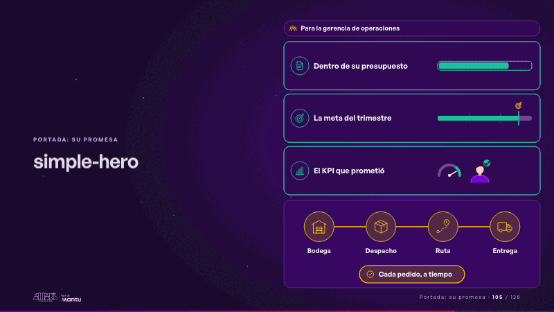
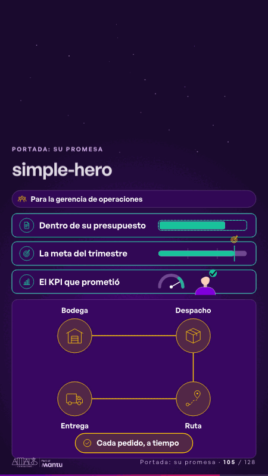

# simple-hero · Portada: su promesa

 

## Qué cuenta

Arriba, para quién es; debajo, sus tres preocupaciones (el presupuesto, la meta del trimestre y el KPI que prometió), cada una con su medidor; abajo, su operación en cuatro estaciones con los íconos de su sector, camino a su promesa.

## Cómo respira

Un envío recorre las cuatro estaciones, que se encienden una a una hasta su promesa; entonces el presupuesto cuadra dentro de su marco, la meta del trimestre llega a su línea y la aguja del KPI entra en verde. Queda: la operación encendida y las tres preocupaciones resueltas.

## Cuándo usarla

Intención: **Portada: su promesa** (hero). Verticales: cualquiera. Layout `left`. Origen: Simple · Andina Logística (demo 0.5.0) · diapositiva «Que cada pedido llegue a tiempo, sin subir el costo». El snippet completo, listo para pegar en un storyboard: [`snippets/simple-hero.json`](../../snippets/simple-hero.json).

## Args

```json
{
 "layout": "left",
 "scene": "simple-hero",
 "args": {
  "who": "‹como: Para la gerencia de operaciones›",
  "worries": [
   "‹como: Dentro de su presupuesto›",
   "‹como: La meta del trimestre›",
   "‹como: El KPI que prometió›"
  ],
  "stations": [
   "‹como: Bodega›",
   "‹como: Despacho›",
   "‹como: Ruta›",
   "‹como: Entrega›"
  ],
  "goal": "‹como: Cada pedido, a tiempo›",
  "icons": [
   "‹como: logistica/bodega›",
   "‹como: logistica/caja›",
   "‹como: logistica/ruta›",
   "‹como: logistica/camion›"
  ]
 }
}
```

## What it is

Cover: their promise scene, layout «left», for any decks. It lands at a glance, then breathes in a slow loop; its args (goal, icons, stations, who, worries) carry every visible word, so the same scene serves a new client once the texts are rewritten.

## Relacionadas · Related

- [arq-hero · Portada: su promesa](arq-hero.md)
- [hero · Portada: su promesa](hero.md)
- [hero-bank · Portada: su promesa](hero-bank.md)
- [hero-care · Portada: su promesa](hero-care.md)
- [hero-network · Portada: su promesa](hero-network.md)
- [hypotheses-quarter · Portada: su promesa](hypotheses-quarter.md)

Fuente · source: [`scenes/story/simple_s01_08.py`](../../scenes/story/simple_s01_08.py) · sha256 `17bb4a9a6f5b`
