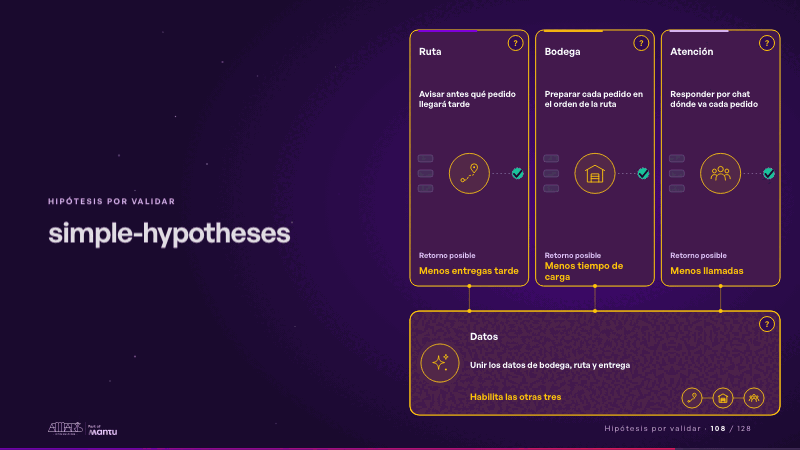
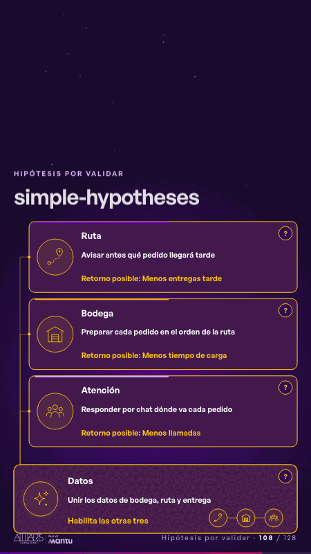

# simple-hypotheses · Hipótesis por validar

 

## Qué cuenta

Tres tarjetas con su ícono, su idea y su retorno posible, cada una con su «?», se apoyan en una cuarta, el habilitador, unida a las tres.

## Cómo respira

Desde el habilitador sube una chispa a cada tarjeta, que se enciende por turnos y hace latir su «?»; al final se enciende el habilitador. Queda: las cuatro encendidas y cada una con su «?»: se eligen juntos.

## Cuándo usarla

Intención: **Hipótesis por validar** (hypotheses). Verticales: cualquiera. Layout `left`. Origen: Simple · Andina Logística (demo 0.5.0) · diapositiva «Cuatro lugares donde la IA podría ayudar, por validar». El snippet completo, listo para pegar en un storyboard: [`snippets/simple-hypotheses.json`](../../snippets/simple-hypotheses.json).

## Args

```json
{
 "layout": "left",
 "scene": "simple-hypotheses",
 "args": {
  "cards": [
   [
    "‹como: Ruta›",
    "‹como: Avisar antes qué pedido llegará tarde›",
    "‹como: Menos entregas tarde›"
   ],
   [
    "‹como: Bodega›",
    "‹como: Preparar cada pedido en el orden de la ruta›",
    "‹como: Menos tiempo de carga›"
   ],
   [
    "‹como: Atención›",
    "‹como: Responder por chat dónde va cada pedido›",
    "‹como: Menos llamadas›"
   ],
   [
    "‹como: Datos›",
    "‹como: Unir los datos de bodega, ruta y entrega›",
    "‹como: Habilita las otras tres›"
   ]
  ],
  "ret": "‹como: Retorno posible›",
  "icons": [
   "‹como: logistica/ruta›",
   "‹como: logistica/bodega›",
   "‹como: generico/equipo›",
   "‹como: logistica/camion›"
  ]
 }
}
```

## What it is

Hypotheses to validate scene, layout «left», for any decks. It lands at a glance, then breathes in a slow loop; its args (cards, icons, ret) carry every visible word, so the same scene serves a new client once the texts are rewritten.

## Relacionadas · Related

- [funnel-gates · Embudo](funnel-gates.md)
- [funnel-weeks · Hipótesis por validar](funnel-weeks.md)
- [hypotheses-bank · Hipótesis por validar](hypotheses-bank.md)
- [hypotheses-care · Hipótesis por validar](hypotheses-care.md)
- [hypotheses-live · Hipótesis por validar](hypotheses-live.md)
- [hypotheses-live-b · Hipótesis por validar](hypotheses-live-b.md)

Fuente · source: [`scenes/story/simple_s01_08.py`](../../scenes/story/simple_s01_08.py) · sha256 `17bb4a9a6f5b`
