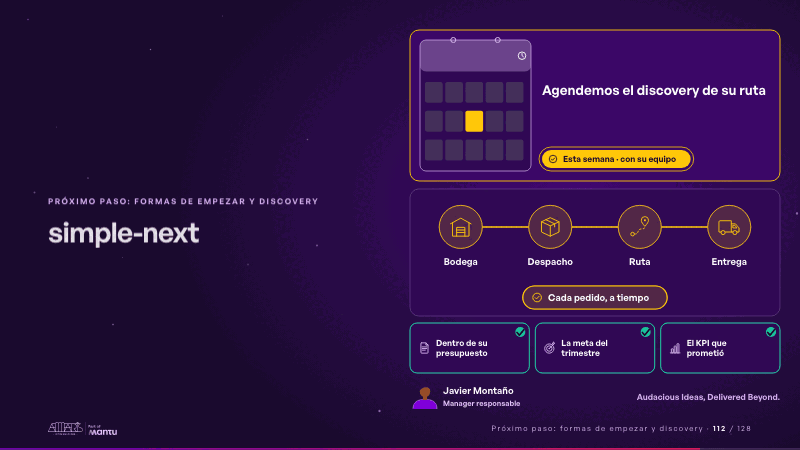
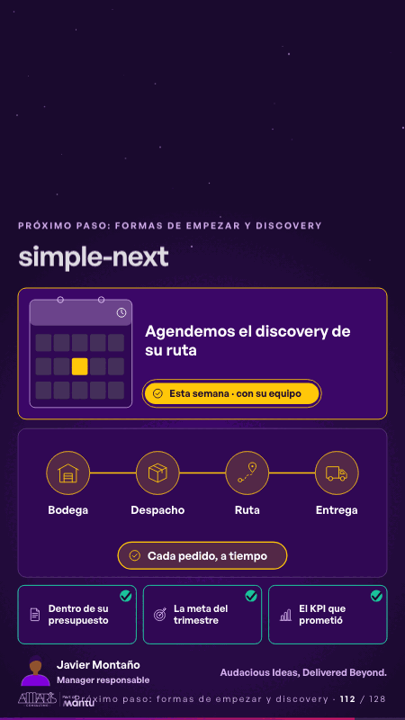

# simple-next · Próximo paso: formas de empezar y discovery

 

## Qué cuenta

Arriba, la invitación con su fecha en un calendario y su botón; en el medio, su operación de la portada; abajo, sus tres preocupaciones y la firma de quien la prepara.

## Cómo respira

El botón late; su operación se enciende estación por estación, como en la portada, y cada preocupación recibe su visto. Queda: su operación encendida, las tres preocupaciones resueltas y la invitación abierta.

## Cuándo usarla

Intención: **Próximo paso: formas de empezar y discovery** (cta, vision). Verticales: cualquiera. Layout `left`. Origen: Simple · Andina Logística (demo 0.5.0) · diapositiva «Empecemos por su meta: en una semana, un prototipo». El snippet completo, listo para pegar en un storyboard: [`snippets/simple-next.json`](../../snippets/simple-next.json).

## Args

```json
{
 "layout": "left",
 "scene": "simple-next",
 "args": {
  "cta": "‹como: Agendemos el discovery de su ruta›",
  "when": "‹como: Esta semana · con su equipo›",
  "worries": [
   "‹como: Dentro de su presupuesto›",
   "‹como: La meta del trimestre›",
   "‹como: El KPI que prometió›"
  ],
  "stations": [
   "‹como: Bodega›",
   "‹como: Despacho›",
   "‹como: Ruta›",
   "‹como: Entrega›"
  ],
  "goal": "‹como: Cada pedido, a tiempo›",
  "sign": "‹como: Audacious Ideas, Delivered Beyond.›",
  "name": "‹como: Javier Montaño›",
  "role": "‹como: Manager responsable›",
  "icons": [
   "‹como: logistica/bodega›",
   "‹como: logistica/caja›",
   "‹como: logistica/ruta›",
   "‹como: logistica/camion›"
  ]
 }
}
```

## What it is

Next step scene, layout «left», for any decks. It lands at a glance, then breathes in a slow loop; its args (cta, goal, icons, name, role, sign, stations, when, worries) carry every visible word, so the same scene serves a new client once the texts are rewritten.

## Relacionadas · Related

- [arq-roadmap · Próximo paso: formas de empezar y discovery](arq-roadmap.md)
- [capacity-join · La prueba y la evidencia](capacity-join.md)
- [care-center · Cierre: su futuro, funcionando (el lema)](care-center.md)
- [controlroom-live · Cierre: su futuro, funcionando (el lema)](controlroom-live.md)
- [discovery · Próximo paso: formas de empezar y discovery](discovery.md)
- [discovery-b · Próximo paso: formas de empezar y discovery](discovery-b.md)

Fuente · source: [`scenes/story/simple_s01_08.py`](../../scenes/story/simple_s01_08.py) · sha256 `17bb4a9a6f5b`
