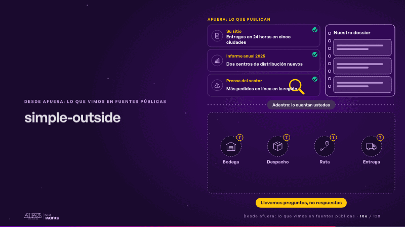
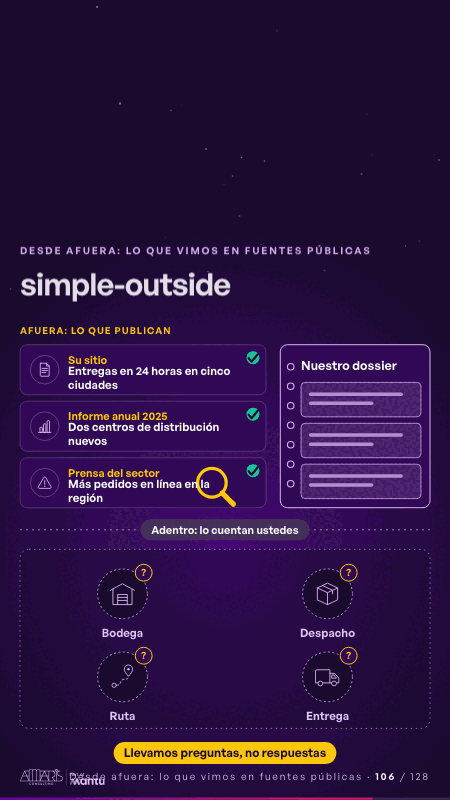

# simple-outside · Desde afuera: lo que vimos en fuentes públicas

 

## Qué cuenta

Arriba, afuera, tres fuentes públicas y nuestro dossier; una línea punteada; abajo, sus cuatro áreas dibujadas en tenue: lo de adentro no lo vemos.

## Cómo respira

La lupa lee cada fuente y una nota vuela al dossier, que se llena; del dossier bajan preguntas, una a cada área, y se enciende «Llevamos preguntas, no respuestas». Queda: las fuentes leídas y una pregunta en cada área.

## Cuándo usarla

Intención: **Desde afuera: lo que vimos en fuentes públicas** (outside). Verticales: cualquiera. Layout `left`. Origen: Simple · Andina Logística (demo 0.5.0) · diapositiva «Esto es lo que vemos desde afuera, en fuentes públicas». El snippet completo, listo para pegar en un storyboard: [`snippets/simple-outside.json`](../../snippets/simple-outside.json).

## Args

```json
{
 "layout": "left",
 "scene": "simple-outside",
 "args": {
  "outside": "‹como: Afuera: lo que publican›",
  "sources": [
   [
    "‹como: Su sitio›",
    "‹como: Entregas en 24 horas en cinco ciudades›"
   ],
   [
    "‹como: Informe anual 2025›",
    "‹como: Dos centros de distribución nuevos›"
   ],
   [
    "‹como: Prensa del sector›",
    "‹como: Más pedidos en línea en la región›"
   ]
  ],
  "book": "‹como: Nuestro dossier›",
  "inside": "‹como: Adentro: lo cuentan ustedes›",
  "areas": [
   "‹como: Bodega›",
   "‹como: Despacho›",
   "‹como: Ruta›",
   "‹como: Entrega›"
  ],
  "ask": "‹como: Llevamos preguntas, no respuestas›",
  "icons": [
   "‹como: logistica/bodega›",
   "‹como: logistica/caja›",
   "‹como: logistica/ruta›",
   "‹como: logistica/camion›"
  ]
 }
}
```

## What it is

Outside view from public sources scene, layout «left», for any decks. It lands at a glance, then breathes in a slow loop; its args (areas, ask, book, icons, inside, outside, sources) carry every visible word, so the same scene serves a new client once the texts are rewritten.

## Relacionadas · Related

- [outside · Desde afuera: lo que vimos en fuentes públicas](outside.md)
- [outside-business · Desde afuera: lo que vimos en fuentes públicas](outside-business.md)
- [outside-teams · Desde afuera: lo que vimos en fuentes públicas](outside-teams.md)

Fuente · source: [`scenes/story/simple_s01_08.py`](../../scenes/story/simple_s01_08.py) · sha256 `17bb4a9a6f5b`
