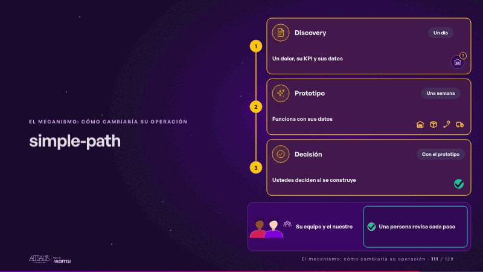
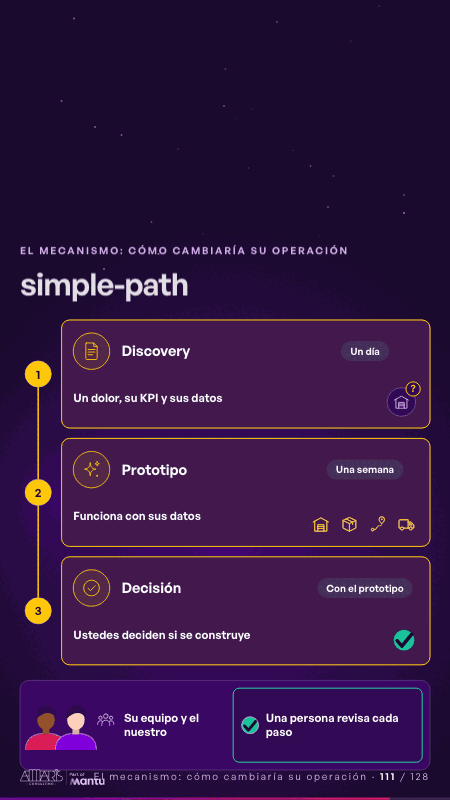

# simple-path · El mecanismo: cómo cambiaría su operación

 

## Qué cuenta

Una ruta de tres pasos numerados (discovery, prototipo y decisión), cada uno con lo que pasa y cuánto dura; abajo, los dos equipos juntos y la persona que revisa.

## Cómo respira

Una chispa baja por la ruta: el discovery se enciende, el prototipo corre sobre su operación y la decisión recibe su visto; al final se enciende «Una persona revisa cada paso». Queda: los tres pasos encendidos y la revisión humana.

## Cuándo usarla

Intención: **El mecanismo: cómo cambiaría su operación** (process). Verticales: cualquiera. Layout `left`. Origen: Simple · Andina Logística (demo 0.5.0) · diapositiva «Tres pasos cortos, y ustedes deciden en cada uno». El snippet completo, listo para pegar en un storyboard: [`snippets/simple-path.json`](../../snippets/simple-path.json).

## Args

```json
{
 "layout": "left",
 "scene": "simple-path",
 "args": {
  "phases": [
   [
    "‹como: Discovery›",
    "‹como: Un dolor, su KPI y sus datos›",
    "‹como: Un día›"
   ],
   [
    "‹como: Prototipo›",
    "‹como: Funciona con sus datos›",
    "‹como: Una semana›"
   ],
   [
    "‹como: Decisión›",
    "‹como: Ustedes deciden si se construye›",
    "‹como: Con el prototipo›"
   ]
  ],
  "team": "‹como: Su equipo y el nuestro›",
  "review": "‹como: Una persona revisa cada paso›",
  "icons": [
   "‹como: logistica/bodega›",
   "‹como: logistica/caja›",
   "‹como: logistica/ruta›",
   "‹como: logistica/camion›"
  ]
 }
}
```

## What it is

The mechanism scene, layout «left», for any decks. It lands at a glance, then breathes in a slow loop; its args (icons, phases, review, team) carry every visible word, so the same scene serves a new client once the texts are rewritten.

## Relacionadas · Related

- [automation-stairs · El mecanismo: cómo cambiaría su operación](automation-stairs.md)
- [before-after-lanes · Antes y después](before-after-lanes.md)
- [before-after-split · Antes y después](before-after-split.md)
- [build-deliver · Formación: la demo en vivo](build-deliver.md)
- [delivery-cycle · El mecanismo: cómo cambiaría su operación](delivery-cycle.md)
- [discovery · Próximo paso: formas de empezar y discovery](discovery.md)

Fuente · source: [`scenes/story/simple_s01_08.py`](../../scenes/story/simple_s01_08.py) · sha256 `17bb4a9a6f5b`
