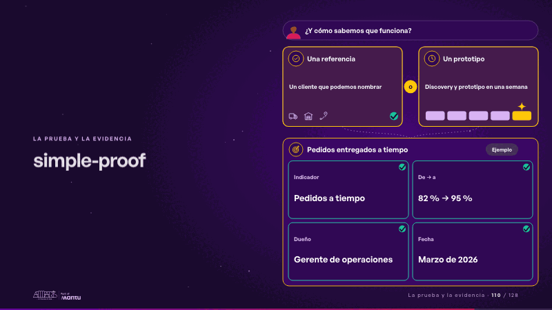
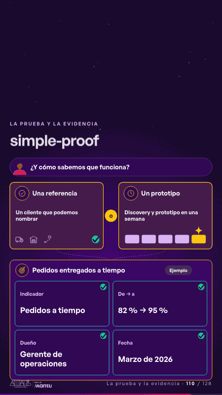

# simple-proof · La prueba y la evidencia

 

## Qué cuenta

Arriba, su pregunta: «¿Y cómo sabemos que funciona?»; dos caminos, una referencia o un prototipo en una semana; abajo, el caso de éxito con su KPI: indicador, de cuánto a cuánto, dueño y fecha.

## Cómo respira

La referencia se enciende; luego la semana del prototipo avanza día a día hasta el prototipo; los dos caminos bajan al caso y cada campo del KPI recibe su visto. Las cifras no se mueven. Queda: el caso con sus cuatro campos validados.

## Cuándo usarla

Intención: **La prueba y la evidencia** (proof, kpi). Verticales: cualquiera. Layout `left`. Origen: Simple · Andina Logística (demo 0.5.0) · diapositiva «La prueba: un caso que movió las entregas a tiempo». El snippet completo, listo para pegar en un storyboard: [`snippets/simple-proof.json`](../../snippets/simple-proof.json).

## Args

```json
{
 "layout": "left",
 "scene": "simple-proof",
 "args": {
  "ask": "‹como: ¿Y cómo sabemos que funciona?›",
  "paths": [
   [
    "‹como: Una referencia›",
    "‹como: Un cliente que podemos nombrar›"
   ],
   [
    "‹como: Un prototipo›",
    "‹como: Discovery y prototipo en una semana›"
   ]
  ],
  "or": "‹como: o›",
  "case": "‹como: Pedidos entregados a tiempo›",
  "kpi": [
   [
    "‹como: Indicador›",
    "‹como: Pedidos a tiempo›"
   ],
   [
    "‹como: De → a›",
    "‹como: 82 % → 95 %›"
   ],
   [
    "‹como: Dueño›",
    "‹como: Gerente de operaciones›"
   ],
   [
    "‹como: Fecha›",
    "‹como: Marzo de 2026›"
   ]
  ],
  "tag": "‹como: Ejemplo›",
  "icons": [
   "‹como: logistica/camion›",
   "‹como: logistica/bodega›",
   "‹como: logistica/ruta›"
  ]
 }
}
```

## What it is

Proof and evidence scene, layout «left», for any decks. It lands at a glance, then breathes in a slow loop; its args (ask, case, icons, kpi, or, paths, tag) carry every visible word, so the same scene serves a new client once the texts are rewritten.

## Relacionadas · Related

- [kpi-card · KPI y casos de éxito](kpi-card.md)
- [mondays-sent · La prueba y la evidencia](mondays-sent.md)
- [report-before-after · La prueba y la evidencia](report-before-after.md)
- [success-case · La prueba y la evidencia](success-case.md)
- [capacity-join · La prueba y la evidencia](capacity-join.md)
- [client-worries · La brecha: su idea y lo que pasa cuando no se cumple](client-worries.md)

Fuente · source: [`scenes/story/simple_s01_08.py`](../../scenes/story/simple_s01_08.py) · sha256 `17bb4a9a6f5b`
