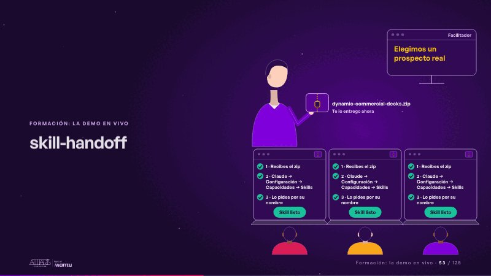
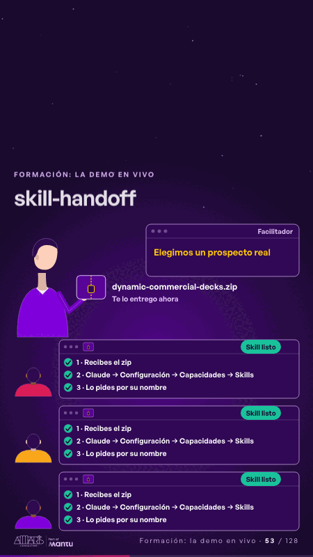

# skill-handoff · Formación: la demo en vivo

 

## Qué cuenta

El facilitador, sin rostro, sostiene el paquete «dynamic-commercial-decks.zip»; en su pantalla, «Comparto el zip en el chat del equipo»; abajo, tres portátiles con sus asistentes de espaldas y los tres pasos de instalación por marcar.

## Cómo respira

Una copia del zip vuela a cada portátil; en cada uno se marcan en orden los tres pasos y aparece «Skill listo»; la pantalla del facilitador pasa a «Elegimos un prospecto real». Cuadro final: todos los portátiles con «Skill listo» y la demo por empezar.

## Cuándo usarla

Intención: **Formación: la demo en vivo** (demo). Verticales: formacion. Layout `left`. Origen: Clase VR (formación) · diapositiva «Demo en vivo: el facilitador te entrega el skill». El snippet completo, listo para pegar en un storyboard: [`snippets/skill-handoff.json`](../../snippets/skill-handoff.json).

## Args

```json
{
 "layout": "left",
 "scene": "skill-handoff",
 "args": {
  "package": "‹como: dynamic-commercial-decks.zip›",
  "hand": "‹como: Te lo entrego ahora›",
  "screen": "‹como: Facilitador›",
  "screen_a": "‹como: Comparto el zip en el chat del equipo›",
  "screen_b": "‹como: Elegimos un prospecto real›",
  "install": [
   "‹como: 1 · Recibes el zip›",
   "‹como: 2 · Claude → Configuración → Capacidades → Skills›",
   "‹como: 3 · Lo pides por su nombre›"
  ],
  "ready": "‹como: Skill listo›"
 }
}
```

## What it is

Training: live demo scene, layout «left», for formacion decks. It lands at a glance, then breathes in a slow loop; its args (hand, install, package, ready, screen, screen_a, screen_b) carry every visible word, so the same scene serves a new client once the texts are rewritten.

## Relacionadas · Related

- [build-deliver · Formación: la demo en vivo](build-deliver.md)
- [live-steps · Formación: la demo en vivo](live-steps.md)
- [client-worries · La brecha: su idea y lo que pasa cuando no se cumple](client-worries.md)
- [facts-columns · Lo que sus equipos comparten: el dato](facts-columns.md)
- [generic-template · La brecha: su idea y lo que pasa cuando no se cumple](generic-template.md)
- [hands-on-timer · Formación: práctica](hands-on-timer.md)

Fuente · source: [`scenes/story/formacion_s13_15.py`](../../scenes/story/formacion_s13_15.py) · sha256 `b70c079dfe51`
