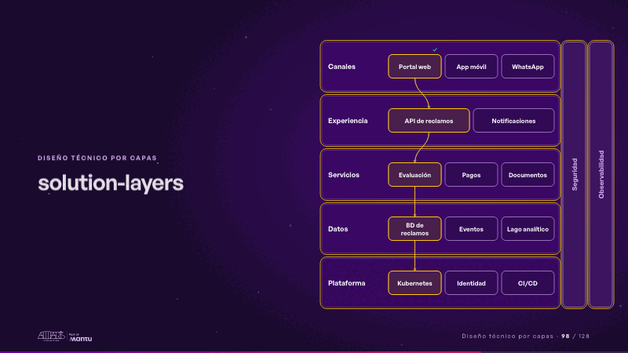
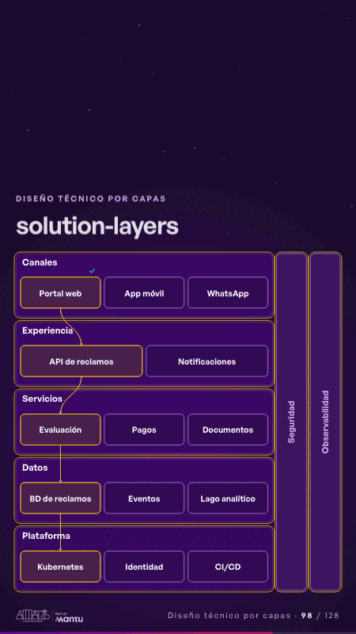

# solution-layers · Diseño técnico por capas

 

## Qué cuenta

Cinco bandas apiladas, de los canales a la plataforma, y dos pilares verticales: seguridad y observabilidad.

## Cómo respira

Una solicitud baja por las capas encendiendo una pieza en cada una, cruza los pilares y la respuesta vuelve arriba con su visto bueno.

## Cuándo usarla

Intención: **Diseño técnico por capas** (architecture, process). Verticales: cualquiera. Layout `left`. Origen: Arquitectura demo (Aseguradora Andina, ficticia) · diapositiva «Cinco capas, de los canales a la plataforma». El snippet completo, listo para pegar en un storyboard: [`snippets/solution-layers.json`](../../snippets/solution-layers.json).

## Args

```json
{
 "layout": "left",
 "scene": "solution-layers",
 "args": {
  "layers": [
   [
    "‹como: Canales›",
    [
     "‹como: Portal web›",
     "‹como: App móvil›",
     "‹como: WhatsApp›"
    ]
   ],
   [
    "‹como: Experiencia›",
    [
     "‹como: API de reclamos›",
     "‹como: Notificaciones›"
    ]
   ],
   [
    "‹como: Servicios›",
    [
     "‹como: Evaluación›",
     "‹como: Pagos›",
     "‹como: Documentos›"
    ]
   ],
   [
    "‹como: Datos›",
    [
     "‹como: BD de reclamos›",
     "‹como: Eventos›",
     "‹como: Lago analítico›"
    ]
   ],
   [
    "‹como: Plataforma›",
    [
     "‹como: Kubernetes›",
     "‹como: Identidad›",
     "‹como: CI/CD›"
    ]
   ]
  ],
  "cross": [
   "‹como: Seguridad›",
   "‹como: Observabilidad›"
  ],
  "path": [
   0,
   0,
   0,
   0,
   0
  ]
 }
}
```

## What it is

Layered technical design scene, layout «left», for any decks. It lands at a glance, then breathes in a slow loop; its args (cross, layers, path) carry every visible word, so the same scene serves a new client once the texts are rewritten.

## Relacionadas · Related

- [automation-stairs · El mecanismo: cómo cambiaría su operación](automation-stairs.md)
- [luz-ladder · Diseño técnico por capas](luz-ladder.md)
- [adr-decisions · Diseño técnico por capas](adr-decisions.md)
- [arq-hero · Portada: su promesa](arq-hero.md)
- [before-after-lanes · Antes y después](before-after-lanes.md)
- [before-after-split · Antes y después](before-after-split.md)

Fuente · source: [`scenes/story/arquitectura.py`](../../scenes/story/arquitectura.py) · sha256 `01c6a4b3e10f`
