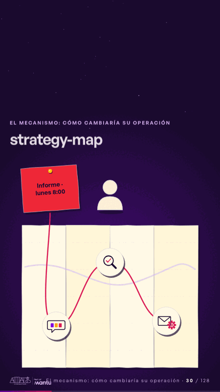

# strategy-map · El mecanismo: cómo cambiaría su operación

 

## Qué cuenta

El post-it rojo clavado a la izquierda, una persona tranquila a su lado y un mapa de papel doblado.

## Cómo respira

El mapa se despliega panel a panel, la cinta magenta sale del post-it y traza la ruta; en cada parada aparece un ícono sin palabras: un chat con fichas, una lupa y un sobre con engranaje. Cuadro final: mapa abierto, ruta trazada, tres íconos y el post-it al inicio.

## Cuándo usarla

Intención: **El mecanismo: cómo cambiaría su operación** (process). Verticales: cualquiera. Layout `left`; mundo papel. Origen: dcd · escena de catálogo (fidelización). El snippet completo, listo para pegar en un storyboard: [`snippets/strategy-map.json`](../../snippets/strategy-map.json).

## Args

```json
{
 "layout": "left",
 "scene": "strategy-map",
 "args": {
  "urgent": "‹como: Informe · lunes 8:00›"
 }
}
```

## What it is

The mechanism scene, layout «left», for any decks. It lands at a glance, then breathes in a slow loop; its args (urgent) carry every visible word, so the same scene serves a new client once the texts are rewritten.

## Relacionadas · Related

- [pinned-request · La brecha: su idea y lo que pasa cuando no se cumple](pinned-request.md)
- [discovery · Próximo paso: formas de empezar y discovery](discovery.md)
- [hypotheses-live · Hipótesis por validar](hypotheses-live.md)
- [lema-signer · Cierre: su futuro, funcionando (el lema)](lema-signer.md)
- [mondays-sent · La prueba y la evidencia](mondays-sent.md)
- [paper-hero · Portada: su promesa](paper-hero.md)

Fuente · source: [`scenes/story/fidelizacion_s01_15.py`](../../scenes/story/fidelizacion_s01_15.py) · sha256 `c89653556c57`
