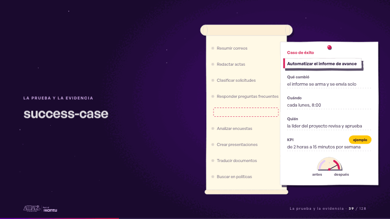
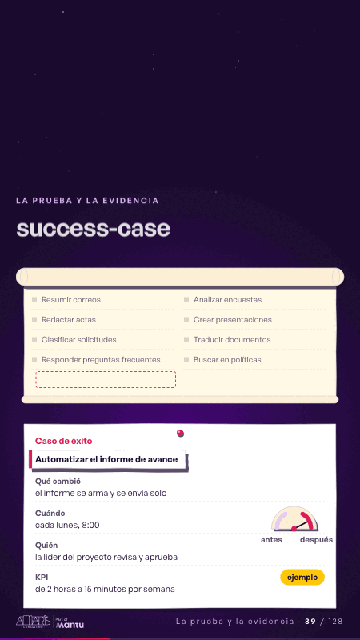

# success-case · La prueba y la evidencia

 

## Qué cuenta

Un rollo de papel que se desenrolla con nueve casos de uso con nombre: resumir correos, redactar actas, clasificar solicitudes y seis más.

## Cómo respira

La línea «Automatizar el informe de avance» se marca con la cinta magenta, sale del rollo y se vuelve, delante, la tarjeta del caso de éxito; sus campos se llenan uno a uno y quedan: qué cambió, cuándo, quién y el KPI con su etiqueta «ejemplo», quieto desde que aparece. Un medidor de papel mueve la aguja de la zona de antes a la de después. Cuadro final: el rollo detrás, la tarjeta completa con sus cuatro campos y la etiqueta, y la aguja ya movida.

## Cuándo usarla

Intención: **La prueba y la evidencia** (proof, kpi). Verticales: cualquiera. Layout `left`; mundo papel. Origen: dcd · escena de catálogo (fidelización). El snippet completo, listo para pegar en un storyboard: [`snippets/success-case.json`](../../snippets/success-case.json).

## Args

```json
{
 "layout": "left",
 "scene": "success-case",
 "args": {
  "cases": [
   "‹como: Resumir correos›",
   "‹como: Redactar actas›",
   "‹como: Clasificar solicitudes›",
   "‹como: Responder preguntas frecuentes›",
   "‹como: Automatizar el informe de avance›",
   "‹como: Analizar encuestas›",
   "‹como: Crear presentaciones›",
   "‹como: Traducir documentos›",
   "‹como: Buscar en políticas›"
  ],
  "pick": "‹como: Automatizar el informe de avance›",
  "card": "‹como: Caso de éxito›",
  "fields": [
   {
    "k": "‹como: Qué cambió›",
    "v": "‹como: el informe se arma y se envía solo›"
   },
   {
    "k": "‹como: Cuándo›",
    "v": "‹como: cada lunes, 8:00›"
   },
   {
    "k": "‹como: Quién›",
    "v": "‹como: la líder del proyecto revisa y aprueba›"
   }
  ],
  "kpi": {
   "k": "‹como: KPI›",
   "v": "‹como: de 2 horas a 15 minutos por semana›",
   "tag": "‹como: ejemplo›"
  },
  "gauge": [
   "‹como: antes›",
   "‹como: después›"
  ]
 }
}
```

## What it is

Proof and evidence scene, layout «left», for any decks. It lands at a glance, then breathes in a slow loop; its args (card, cases, fields, gauge, kpi, pick) carry every visible word, so the same scene serves a new client once the texts are rewritten.

## Relacionadas · Related

- [kpi-card · KPI y casos de éxito](kpi-card.md)
- [mondays-sent · La prueba y la evidencia](mondays-sent.md)
- [report-before-after · La prueba y la evidencia](report-before-after.md)
- [simple-proof · La prueba y la evidencia](simple-proof.md)
- [capacity-join · La prueba y la evidencia](capacity-join.md)
- [client-worries · La brecha: su idea y lo que pasa cuando no se cumple](client-worries.md)

Fuente · source: [`scenes/story/fidelizacion_s01_15.py`](../../scenes/story/fidelizacion_s01_15.py) · sha256 `c89653556c57`
