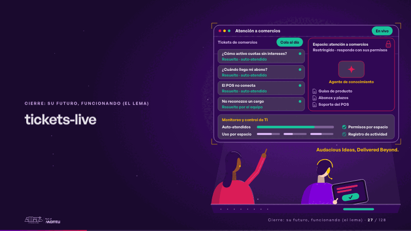
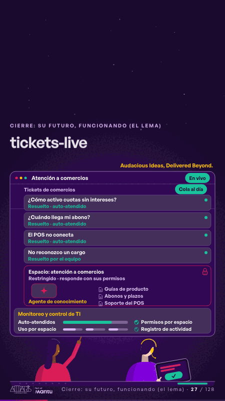

# tickets-live · Cierre: su futuro, funcionando (el lema)

 

## Qué cuenta

El prototipo crece hasta la pantalla de atención a comercios en vivo: cuatro tickets, el espacio restringido del agente con su candado y sus fuentes y, abajo, el monitoreo de TI; delante, de espaldas, dos personas en su consola.

## Cómo respira

Un bucle de 12 segundos: cada consulta simple viaja al agente, se enciende la fuente de la que responde y el ticket se cierra solo; la sensible, un cargo que el comercio no reconoce, enciende el candado y pasa a la tablet de una persona con su contexto; él la resuelve y la cola queda al día. La barra de auto-atendidos crece sin cifra.

## Cuándo usarla

Intención: **Cierre: su futuro, funcionando (el lema)** (vision, process). Verticales: pagos, cualquiera. Layout `left`. Origen: dcd · escena de catálogo (pagos). El snippet completo, listo para pegar en un storyboard: [`snippets/tickets-live.json`](../../snippets/tickets-live.json).

## Args

```json
{
 "layout": "left",
 "scene": "tickets-live",
 "args": {
  "screen": "‹como: Atención a comercios›",
  "queue": "‹como: Tickets de comercios›",
  "tickets": [
   "‹como: ¿Cómo activo cuotas sin intereses?›",
   "‹como: ¿Cuándo llega mi abono?›",
   "‹como: El POS no conecta›",
   "‹como: No reconozco un cargo›"
  ],
  "new": "‹como: Nuevo›",
  "solved": "‹como: Resuelto · auto-atendido›",
  "routed": "‹como: Sensible · a una persona, con contexto›",
  "closed": "‹como: Resuelto por el equipo›",
  "calm": "‹como: Cola al día›",
  "space": "‹como: Espacio: atención a comercios›",
  "space_sub": "‹como: Restringido · responde con sus permisos›",
  "agent": "‹como: Agente de conocimiento›",
  "docs": [
   "‹como: Guías de producto›",
   "‹como: Abonos y plazos›",
   "‹como: Soporte del POS›"
  ],
  "monitor": "‹como: Monitoreo y control de TI›",
  "share": "‹como: Auto-atendidos›",
  "usage": "‹como: Uso por espacio›",
  "rows": [
   "‹como: Permisos por espacio›",
   "‹como: Registro de actividad›"
  ],
  "review": "‹como: Resolver›",
  "sign": "‹como: Audacious Ideas, Delivered Beyond.›",
  "live": "‹como: En vivo›"
 }
}
```

## What it is

Closing: their future, working scene, layout «left», for pagos, any decks. It lands at a glance, then breathes in a slow loop; its args (agent, calm, closed, docs, live, monitor, new, queue, review, routed, rows, screen, share, sign, solved, space, space_sub, tickets, usage) carry every visible…

## Relacionadas · Related

- [discovery · Próximo paso: formas de empezar y discovery](discovery.md)
- [repeat-story · La brecha: su idea y lo que pasa cuando no se cumple](repeat-story.md)
- [hypotheses-live · Hipótesis por validar](hypotheses-live.md)
- [hypotheses-quarter · Portada: su promesa](hypotheses-quarter.md)
- [criterion · El criterio: retorno o habilitador](criterion.md)
- [outside-business · Desde afuera: lo que vimos en fuentes públicas](outside-business.md)

Fuente · source: [`scenes/story/pagos_s13_15.py`](../../scenes/story/pagos_s13_15.py) · sha256 `de77ed17064f`
