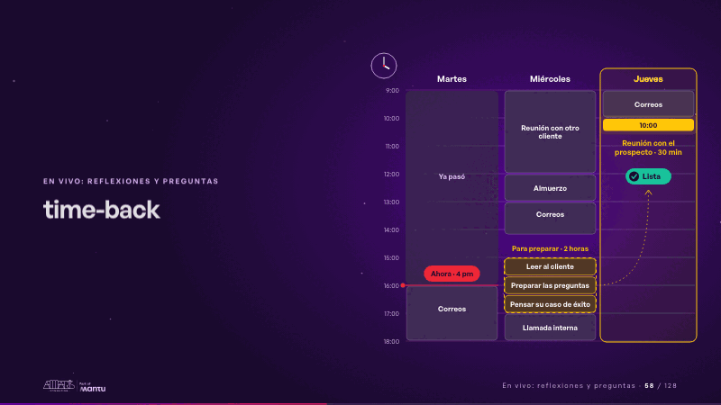
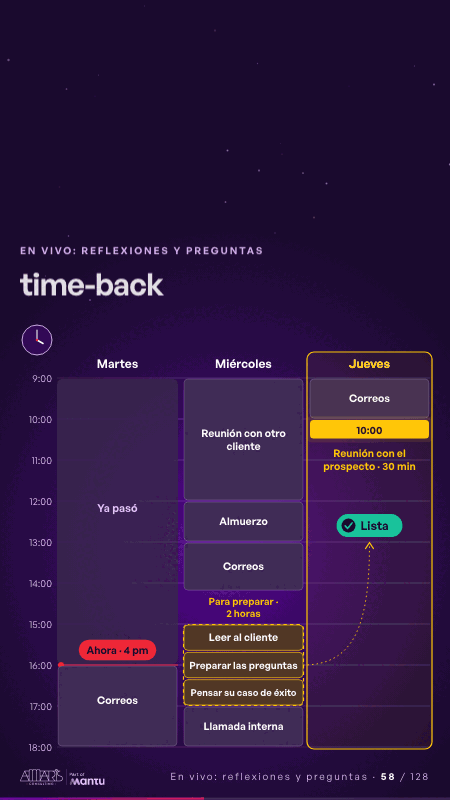

# time-back · En vivo: reflexiones y preguntas

 

## Qué cuenta

La misma semana de la diapositiva 2: el martes a las 4 pm, el jueves 10:00 con el prospecto y, el miércoles, tus dos horas para preparar ocupadas por «Mover cajas», «Buscar una plantilla» y «Ajustar el formato».

## Cómo respira

Cada tarea de formato se deshace en cajitas y en su lugar se enciende una para el cliente: «Leer al cliente», «Preparar las preguntas», «Pensar su caso de éxito»; un hilo las lleva al jueves, que se enciende con su visto: «Lista». Cuadro final: los tres bloques nuevos encendidos y la reunión lista.

## Cuándo usarla

Intención: **En vivo: reflexiones y preguntas** (reflection, vision). Verticales: formacion. Layout `left`. Origen: Clase VR (formación) · diapositiva «¿Qué harías con las horas que ya no pasas diagramando?». El snippet completo, listo para pegar en un storyboard: [`snippets/time-back.json`](../../snippets/time-back.json).

## Args

```json
{
 "layout": "left",
 "scene": "time-back",
 "args": {
  "days": [
   "‹como: Martes›",
   "‹como: Miércoles›",
   "‹como: Jueves›"
  ],
  "past": "‹como: Ya pasó›",
  "now": "‹como: Ahora · 4 pm›",
  "meet_time": "‹como: 10:00›",
  "meet": "‹como: Reunión con el prospecto · 30 min›",
  "busy": [
   [
    0,
    16,
    18,
    "‹como: Correos›"
   ],
   [
    1,
    9,
    12,
    "‹como: Reunión con otro cliente›"
   ],
   [
    1,
    12,
    13,
    "‹como: Almuerzo›"
   ],
   [
    1,
    13,
    14.2,
    "‹como: Correos›"
   ],
   [
    1,
    17,
    18,
    "‹como: Llamada interna›"
   ],
   [
    2,
    9,
    10,
    "‹como: Correos›"
   ]
  ],
  "free": [
   1,
   15,
   17
  ],
  "prep": "‹como: Para preparar · 2 horas›",
  "before": [
   "‹como: Mover cajas›",
   "‹como: Buscar una plantilla›",
   "‹como: Ajustar el formato›"
  ],
  "after": [
   "‹como: Leer al cliente›",
   "‹como: Preparar las preguntas›",
   "‹como: Pensar su caso de éxito›"
  ],
  "ready": "‹como: Lista›"
 }
}
```

## What it is

Live: reflections and questions scene, layout «left», for formacion decks. It lands at a glance, then breathes in a slow loop; its args (after, before, busy, days, free, meet, meet_time, now, past, prep, ready) carry every visible word, so the same scene serves a new client once the texts are…

## Relacionadas · Related

- [time-freed · En vivo: reflexiones y preguntas](time-freed.md)
- [lema-conversation · Cierre: su futuro, funcionando (el lema)](lema-conversation.md)
- [arq-roadmap · Próximo paso: formas de empezar y discovery](arq-roadmap.md)
- [care-center · Cierre: su futuro, funcionando (el lema)](care-center.md)
- [chain-tap · Diseño técnico por capas](chain-tap.md)
- [controlroom-live · Cierre: su futuro, funcionando (el lema)](controlroom-live.md)

Fuente · source: [`scenes/story/formacion_s19_20.py`](../../scenes/story/formacion_s19_20.py) · sha256 `239f62ef0885`
