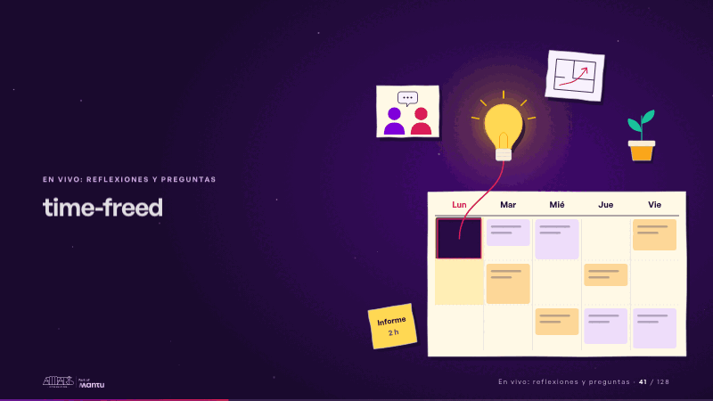
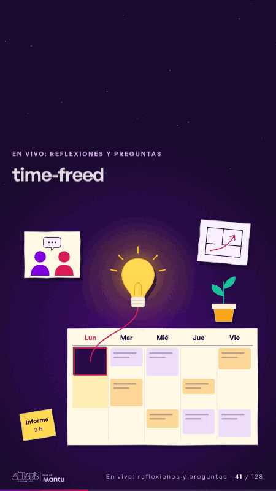

# time-freed · En vivo: reflexiones y preguntas

 

## Qué cuenta

El calendario de papel de la semana, con el lunes en la mañana resaltado y su bloque de dos horas: el informe.

## Cómo respira

La cinta magenta recorta del lunes el bloque de dos horas; la pieza se levanta y se posa al lado, dejando el hueco con su sombra; del hueco sube una bombilla de papel que se enciende y a su alrededor aparecen tres ideas sin palabras: dos personas conversando, un plano, una planta que crece. Cuadro final: hueco recortado, bombilla encendida y las tres ideas.

## Cuándo usarla

Intención: **En vivo: reflexiones y preguntas** (reflection, vision). Verticales: cualquiera. Layout `left`; mundo papel. Origen: dcd · escena de catálogo (fidelización). El snippet completo, listo para pegar en un storyboard: [`snippets/time-freed.json`](../../snippets/time-freed.json).

## Args

```json
{
 "layout": "left",
 "scene": "time-freed",
 "args": {
  "days": [
   "‹como: Lun›",
   "‹como: Mar›",
   "‹como: Mié›",
   "‹como: Jue›",
   "‹como: Vie›"
  ],
  "block": [
   "‹como: Informe›",
   "‹como: 2 h›"
  ]
 }
}
```

## What it is

Live: reflections and questions scene, layout «left», for any decks. It lands at a glance, then breathes in a slow loop; its args (block, days) carry every visible word, so the same scene serves a new client once the texts are rewritten.

## Relacionadas · Related

- [time-back · En vivo: reflexiones y preguntas](time-back.md)
- [arq-roadmap · Próximo paso: formas de empezar y discovery](arq-roadmap.md)
- [care-center · Cierre: su futuro, funcionando (el lema)](care-center.md)
- [chain-tap · Diseño técnico por capas](chain-tap.md)
- [controlroom-live · Cierre: su futuro, funcionando (el lema)](controlroom-live.md)
- [lema-conversation · Cierre: su futuro, funcionando (el lema)](lema-conversation.md)

Fuente · source: [`scenes/story/fidelizacion_s01_15.py`](../../scenes/story/fidelizacion_s01_15.py) · sha256 `c89653556c57`
