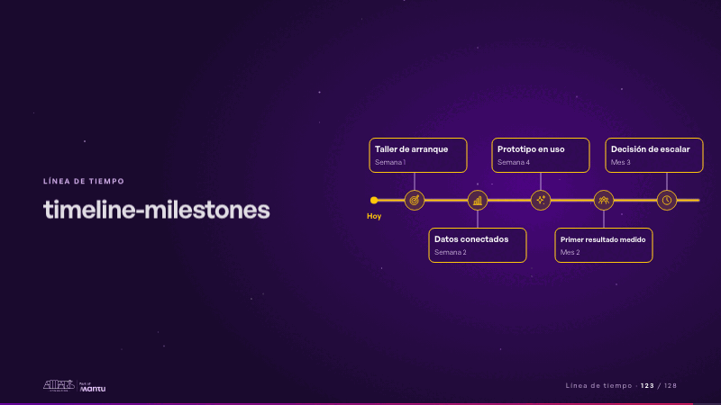
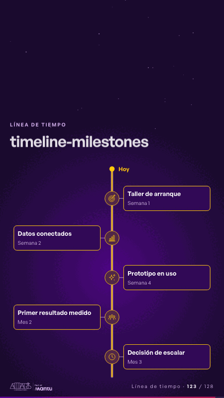

# timeline-milestones · Línea de tiempo

 

## Qué cuenta

Una línea desde «Hoy» con cinco hitos, cada uno con su periodo, su nombre y un ícono de su sector, alternando a un lado y al otro.

## Cómo respira

Un cursor recorre la línea y la deja encendida; cada hito se enciende al paso. Queda: los cinco hitos alcanzados.

## Cuándo usarla

Intención: **Línea de tiempo** (timeline, roadmap). Verticales: cualquiera. Layout `left`. Origen: dcd 0.6.0 · escena de catálogo. El snippet completo, listo para pegar en un storyboard: [`snippets/timeline-milestones.json`](../../snippets/timeline-milestones.json).

## Args

```json
{
 "layout": "left",
 "scene": "timeline-milestones",
 "args": {
  "now": "‹como: Hoy›",
  "events": [
   [
    "‹como: Semana 1›",
    "‹como: Taller de arranque›"
   ],
   [
    "‹como: Semana 2›",
    "‹como: Datos conectados›"
   ],
   [
    "‹como: Semana 4›",
    "‹como: Prototipo en uso›"
   ],
   [
    "‹como: Mes 2›",
    "‹como: Primer resultado medido›"
   ],
   [
    "‹como: Mes 3›",
    "‹como: Decisión de escalar›"
   ]
  ]
 }
}
```

## What it is

Timeline scene, layout «left», for any decks. It lands at a glance, then breathes in a slow loop; its args (events, now) carry every visible word, so the same scene serves a new client once the texts are rewritten.

## Relacionadas · Related

- [timeline-tracks · Línea de tiempo](timeline-tracks.md)
- [roadmap-phases · Hoja de ruta](roadmap-phases.md)
- [roadmap-road · Hoja de ruta](roadmap-road.md)

Fuente · source: [`scenes/story/intents_s09_16.py`](../../scenes/story/intents_s09_16.py) · sha256 `cf63c5919182`
