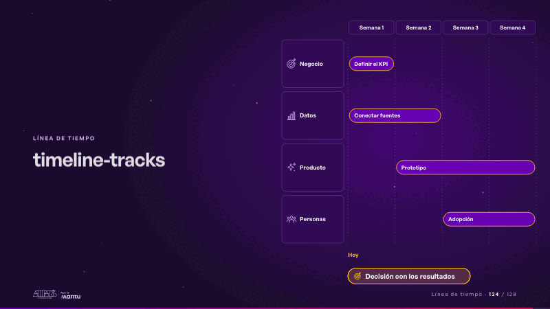
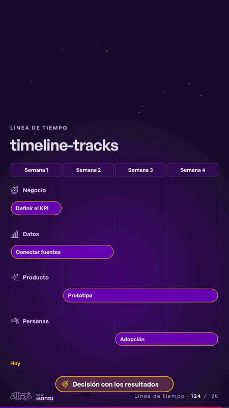

# timeline-tracks · Línea de tiempo

 

## Qué cuenta

Cuatro frentes en filas, con un ícono de su sector, y cuatro semanas en columnas; cada frente con su tramo punteado; abajo, la decisión.

## Cómo respira

La línea de hoy barre las semanas y cada barra crece a su paso; al completarse, aparece lo que entrega; al final se enciende la decisión. Queda: las cuatro barras completas.

## Cuándo usarla

Intención: **Línea de tiempo** (timeline, roadmap, process). Verticales: cualquiera. Layout `left`. Origen: dcd 0.6.0 · escena de catálogo. El snippet completo, listo para pegar en un storyboard: [`snippets/timeline-tracks.json`](../../snippets/timeline-tracks.json).

## Args

```json
{
 "layout": "left",
 "scene": "timeline-tracks",
 "args": {
  "periods": [
   "‹como: Semana 1›",
   "‹como: Semana 2›",
   "‹como: Semana 3›",
   "‹como: Semana 4›"
  ],
  "tracks": [
   [
    "‹como: Negocio›",
    0,
    1,
    "‹como: Definir el KPI›"
   ],
   [
    "‹como: Datos›",
    0,
    2,
    "‹como: Conectar fuentes›"
   ],
   [
    "‹como: Producto›",
    1,
    4,
    "‹como: Prototipo›"
   ],
   [
    "‹como: Personas›",
    2,
    4,
    "‹como: Adopción›"
   ]
  ],
  "today": "‹como: Hoy›",
  "gate": "‹como: Decisión con los resultados›"
 }
}
```

## What it is

Timeline scene, layout «left», for any decks. It lands at a glance, then breathes in a slow loop; its args (gate, periods, today, tracks) carry every visible word, so the same scene serves a new client once the texts are rewritten.

## Relacionadas · Related

- [roadmap-phases · Hoja de ruta](roadmap-phases.md)
- [timeline-milestones · Línea de tiempo](timeline-milestones.md)
- [automation-stairs · El mecanismo: cómo cambiaría su operación](automation-stairs.md)
- [before-after-lanes · Antes y después](before-after-lanes.md)
- [before-after-split · Antes y después](before-after-split.md)
- [build-deliver · Formación: la demo en vivo](build-deliver.md)

Fuente · source: [`scenes/story/intents_s09_16.py`](../../scenes/story/intents_s09_16.py) · sha256 `cf63c5919182`
