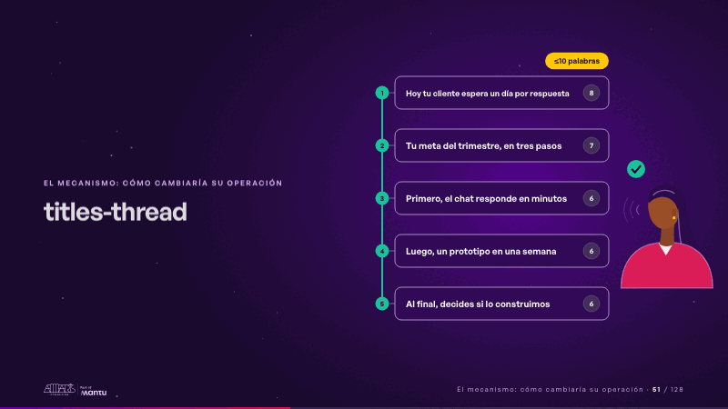
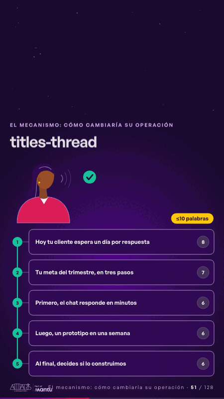

# titles-thread · El mecanismo: cómo cambiaría su operación

 

## Qué cuenta

Una columna de cinco títulos cortos, numerados y unidos por un hilo punteado, cada uno con su conteo de palabras bajo «≤10 palabras»; a la derecha, una persona sin rostro que los lee en voz alta.

## Cómo respira

La persona lee en orden y el hilo se traza de un título al siguiente; en «Nuestras capacidades» el hilo se rompe en rojo y aparece un «?»; el título se reescribe como «Tu meta del trimestre, en tres pasos», el hilo se repara, la lectura sigue hasta el final y el hilo entero se cierra en verde. Cuadro final: todos los títulos unidos por un solo hilo continuo.

## Cuándo usarla

Intención: **El mecanismo: cómo cambiaría su operación** (process). Verticales: formacion. Layout `left`. Origen: Clase VR (formación) · diapositiva «Lee tus títulos seguidos: deben contar la historia». El snippet completo, listo para pegar en un storyboard: [`snippets/titles-thread.json`](../../snippets/titles-thread.json).

## Args

```json
{
 "layout": "left",
 "scene": "titles-thread",
 "args": {
  "titles": [
   "‹como: Hoy tu cliente espera un día por respuesta›",
   "‹como: Nuestras capacidades›",
   "‹como: Primero, el chat responde en minutos›",
   "‹como: Luego, un prototipo en una semana›",
   "‹como: Al final, decides si lo construimos›"
  ],
  "weak": 1,
  "fix": "‹como: Tu meta del trimestre, en tres pasos›",
  "limit": "‹como: ≤10 palabras›"
 }
}
```

## What it is

The mechanism scene, layout «left», for formacion decks. It lands at a glance, then breathes in a slow loop; its args (fix, limit, titles, weak) carry every visible word, so the same scene serves a new client once the texts are rewritten.

## Relacionadas · Related

- [build-deliver · Formación: la demo en vivo](build-deliver.md)
- [live-steps · Formación: la demo en vivo](live-steps.md)
- [mirroring · El mecanismo: cómo cambiaría su operación](mirroring.md)
- [two-seconds · El mecanismo: cómo cambiaría su operación](two-seconds.md)
- [automation-stairs · El mecanismo: cómo cambiaría su operación](automation-stairs.md)
- [before-after-lanes · Antes y después](before-after-lanes.md)

Fuente · source: [`scenes/story/formacion_s10_12.py`](../../scenes/story/formacion_s10_12.py) · sha256 `e51f23629e2f`
