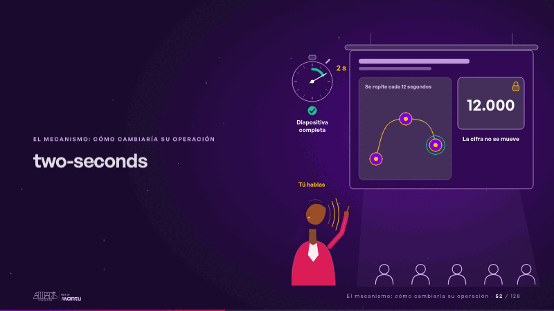
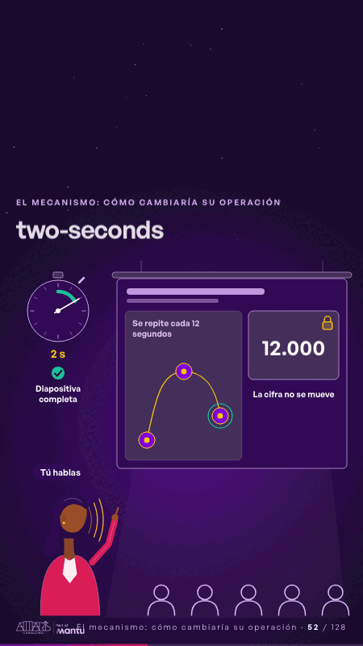

# two-seconds · El mecanismo: cómo cambiaría su operación

 

## Qué cuenta

Una diapositiva en la pantalla del proyector: un cronómetro corre y, antes de 2 s, están el título, la escena y la cifra «12.000» con su candado; la presentadora, sin rostro, la señala.

## Cómo respira

El cronómetro se detiene en «2 s», «Diapositiva completa»; mientras la presentadora habla, dentro de la diapositiva un punto enciende tres pasos en orden y la cifra no se mueve. Cuadro final: diapositiva completa, historia resuelta, cifra con candado y la marca de 2 s.

## Cuándo usarla

Intención: **El mecanismo: cómo cambiaría su operación** (process). Verticales: formacion. Layout `left`. Origen: Clase VR (formación) · diapositiva «Cada diapositiva se entiende en dos segundos, sin esperar». El snippet completo, listo para pegar en un storyboard: [`snippets/two-seconds.json`](../../snippets/two-seconds.json).

## Args

```json
{
 "layout": "left",
 "scene": "two-seconds",
 "args": {
  "number": "‹como: 12.000›",
  "still": "‹como: La cifra no se mueve›",
  "clock": "‹como: 2 s›",
  "done": "‹como: Diapositiva completa›",
  "talk": "‹como: Tú hablas›",
  "story": "‹como: Se repite cada 12 segundos›"
 }
}
```

## What it is

The mechanism scene, layout «left», for formacion decks. It lands at a glance, then breathes in a slow loop; its args (clock, done, number, still, story, talk) carry every visible word, so the same scene serves a new client once the texts are rewritten.

## Relacionadas · Related

- [build-deliver · Formación: la demo en vivo](build-deliver.md)
- [live-steps · Formación: la demo en vivo](live-steps.md)
- [mirroring · El mecanismo: cómo cambiaría su operación](mirroring.md)
- [titles-thread · El mecanismo: cómo cambiaría su operación](titles-thread.md)
- [automation-stairs · El mecanismo: cómo cambiaría su operación](automation-stairs.md)
- [before-after-lanes · Antes y después](before-after-lanes.md)

Fuente · source: [`scenes/story/formacion_s13_15.py`](../../scenes/story/formacion_s13_15.py) · sha256 `b70c079dfe51`
