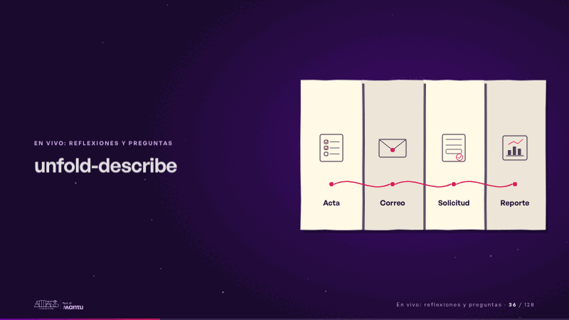
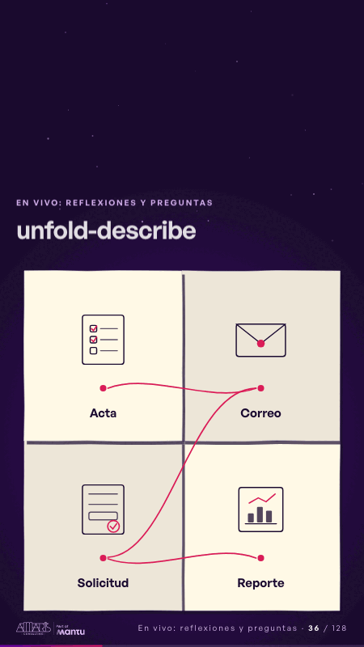

# unfold-describe · En vivo: reflexiones y preguntas

 

## Qué cuenta

La hoja del informe, doblada.

## Cómo respira

La portada del informe se levanta y la hoja se despliega en cuatro paneles, cada uno otra tarea que se repite: acta, correo, solicitud, reporte; la cinta magenta los une uno a uno y, antes de reiniciar, la hoja se vuelve a doblar. Cuadro final: hoja abierta con los cuatro paneles unidos.

## Cuándo usarla

Intención: **En vivo: reflexiones y preguntas** (reflection). Verticales: cualquiera. Layout `left`; mundo papel. Origen: dcd · escena de catálogo (fidelización). El snippet completo, listo para pegar en un storyboard: [`snippets/unfold-describe.json`](../../snippets/unfold-describe.json).

## Args

```json
{
 "layout": "left",
 "scene": "unfold-describe",
 "args": {
  "cover": "‹como: El informe›",
  "panels": [
   "‹como: Acta›",
   "‹como: Correo›",
   "‹como: Solicitud›",
   "‹como: Reporte›"
  ]
 }
}
```

## What it is

Live: reflections and questions scene, layout «left», for any decks. It lands at a glance, then breathes in a slow loop; its args (cover, panels) carry every visible word, so the same scene serves a new client once the texts are rewritten.

## Relacionadas · Related

- [chain-tap · Diseño técnico por capas](chain-tap.md)
- [luz-question · En vivo: reflexiones y preguntas](luz-question.md)
- [reflections-cards · En vivo: reflexiones y preguntas](reflections-cards.md)
- [reflections-live · En vivo: reflexiones y preguntas](reflections-live.md)
- [time-back · En vivo: reflexiones y preguntas](time-back.md)
- [time-freed · En vivo: reflexiones y preguntas](time-freed.md)

Fuente · source: [`scenes/story/fidelizacion_s01_15.py`](../../scenes/story/fidelizacion_s01_15.py) · sha256 `c89653556c57`
