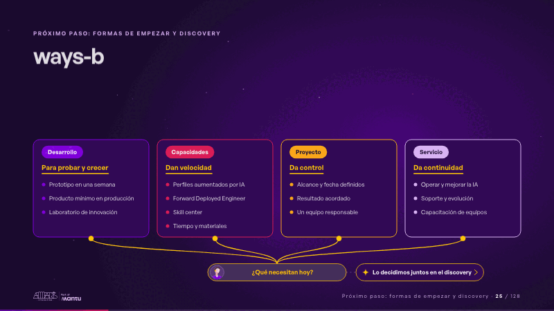
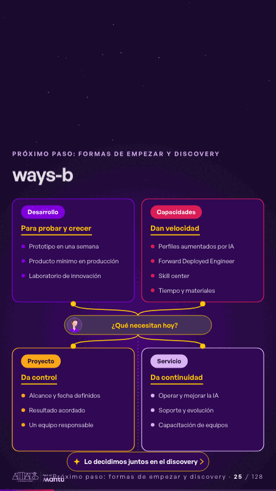

# ways-b · Próximo paso: formas de empezar y discovery

 

## Qué cuenta

Cuatro columnas se abren (desarrollo, capacidades, proyecto y servicio) y, debajo, un árbol une sus bases con una sola raíz que pregunta «¿Qué necesitan hoy?».

## Cómo respira

La pregunta se vuelve una necesidad a la vez (probar, velocidad, control, continuidad) y una chispa sube por su rama hasta la forma que la resuelve, que se enciende y subraya su promesa; cuando vuelve la pregunta, una chispa sale hacia la derecha y enciende «Lo decidimos juntos en el discovery».

## Cuándo usarla

Intención: **Próximo paso: formas de empezar y discovery** (cta). Verticales: cualquiera. Layout `top`. Origen: dcd · escena de catálogo (pagos). El snippet completo, listo para pegar en un storyboard: [`snippets/ways-b.json`](../../snippets/ways-b.json).

## Args

```json
{
 "layout": "top",
 "scene": "ways-b",
 "args": {
  "models": [
   [
    "‹como: Desarrollo›",
    "‹como: Para probar y crecer›",
    [
     "‹como: Prototipo en una semana›",
     "‹como: Producto mínimo en producción›",
     "‹como: Laboratorio de innovación›"
    ]
   ],
   [
    "‹como: Capacidades›",
    "‹como: Dan velocidad›",
    [
     "‹como: Perfiles aumentados por IA›",
     "‹como: Forward Deployed Engineer›",
     "‹como: Skill center›",
     "‹como: Tiempo y materiales›"
    ]
   ],
   [
    "‹como: Proyecto›",
    "‹como: Da control›",
    [
     "‹como: Alcance y fecha definidos›",
     "‹como: Resultado acordado›",
     "‹como: Un equipo responsable›"
    ]
   ],
   [
    "‹como: Servicio›",
    "‹como: Da continuidad›",
    [
     "‹como: Operar y mejorar la IA›",
     "‹como: Soporte y evolución›",
     "‹como: Capacitación de equipos›"
    ]
   ]
  ],
  "ask": "‹como: ¿Qué necesitan hoy?›",
  "needs": [
   "‹como: Queremos probar›",
   "‹como: Necesitamos velocidad›",
   "‹como: Necesitamos control›",
   "‹como: Necesitamos continuidad›"
  ],
  "next": "‹como: Lo decidimos juntos en el discovery›"
 }
}
```

## What it is

Next step scene, layout «top», for any decks. It lands at a glance, then breathes in a slow loop; its args (ask, models, needs, next) carry every visible word, so the same scene serves a new client once the texts are rewritten.

## Relacionadas · Related

- [arq-roadmap · Próximo paso: formas de empezar y discovery](arq-roadmap.md)
- [capacity-join · La prueba y la evidencia](capacity-join.md)
- [discovery · Próximo paso: formas de empezar y discovery](discovery.md)
- [discovery-b · Próximo paso: formas de empezar y discovery](discovery-b.md)
- [proof-paths · La prueba y la evidencia](proof-paths.md)
- [reflections-live · En vivo: reflexiones y preguntas](reflections-live.md)

Fuente · source: [`scenes/story/pagos_s10_12.py`](../../scenes/story/pagos_s10_12.py) · sha256 `7f6085991e6e`
