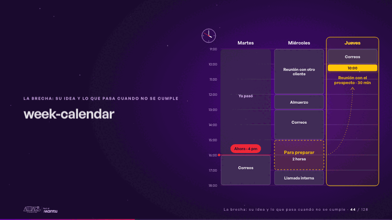
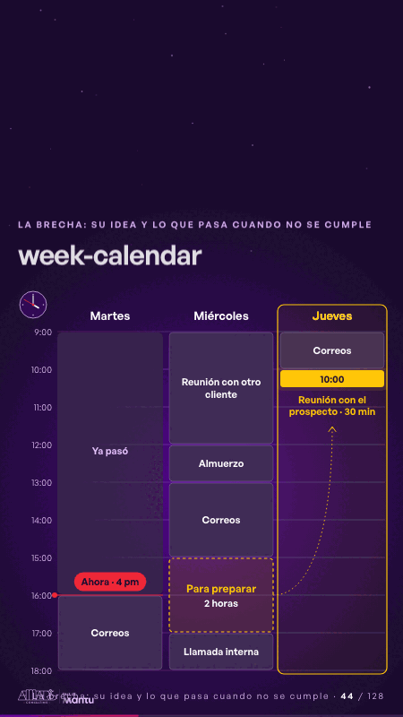

# week-calendar · La brecha: su idea y lo que pasa cuando no se cumple

 

## Qué cuenta

Tu semana de martes a jueves: el martes hasta las 4 pm ya pasó, un reloj marca las 4:00 y el jueves a las 10:00 brilla la reunión con el prospecto.

## Cómo respira

El reloj avanza; correos, otra reunión, el almuerzo y una llamada llenan los huecos uno a uno; quedan dos horas libres el miércoles, se marcan «Para preparar» y un hilo las une al jueves, que se enciende. Cuadro final: la semana llena, las dos horas marcadas, el jueves resaltado.

## Cuándo usarla

Intención: **La brecha: su idea y lo que pasa cuando no se cumple** (gap). Verticales: formacion. Layout `left`. Origen: Clase VR (formación) · diapositiva «Martes, 4 pm: el jueves conoces a un prospecto». El snippet completo, listo para pegar en un storyboard: [`snippets/week-calendar.json`](../../snippets/week-calendar.json).

## Args

```json
{
 "layout": "left",
 "scene": "week-calendar",
 "args": {
  "days": [
   "‹como: Martes›",
   "‹como: Miércoles›",
   "‹como: Jueves›"
  ],
  "past": "‹como: Ya pasó›",
  "now": "‹como: Ahora · 4 pm›",
  "meet_time": "‹como: 10:00›",
  "meet": "‹como: Reunión con el prospecto · 30 min›",
  "busy": [
   [
    0,
    16,
    18,
    "‹como: Correos›"
   ],
   [
    1,
    9,
    12,
    "‹como: Reunión con otro cliente›"
   ],
   [
    1,
    12,
    13,
    "‹como: Almuerzo›"
   ],
   [
    1,
    13,
    15,
    "‹como: Correos›"
   ],
   [
    1,
    17,
    18,
    "‹como: Llamada interna›"
   ],
   [
    2,
    9,
    10,
    "‹como: Correos›"
   ]
  ],
  "free": [
   1,
   15,
   17
  ],
  "prep": "‹como: Para preparar›",
  "prep_hours": "‹como: 2 horas›"
 }
}
```

## What it is

The gap scene, layout «left», for formacion decks. It lands at a glance, then breathes in a slow loop; its args (busy, days, free, meet, meet_time, now, past, prep, prep_hours) carry every visible word, so the same scene serves a new client once the texts are rewritten.

## Relacionadas · Related

- [prospect-cover · Portada: su promesa](prospect-cover.md)
- [hypotheses-live · Hipótesis por validar](hypotheses-live.md)
- [lema-conversation · Cierre: su futuro, funcionando (el lema)](lema-conversation.md)
- [discovery · Próximo paso: formas de empezar y discovery](discovery.md)
- [criterion · El criterio: retorno o habilitador](criterion.md)
- [outside-business · Desde afuera: lo que vimos en fuentes públicas](outside-business.md)

Fuente · source: [`scenes/story/formacion_s01_03.py`](../../scenes/story/formacion_s01_03.py) · sha256 `68ee479403f2`
